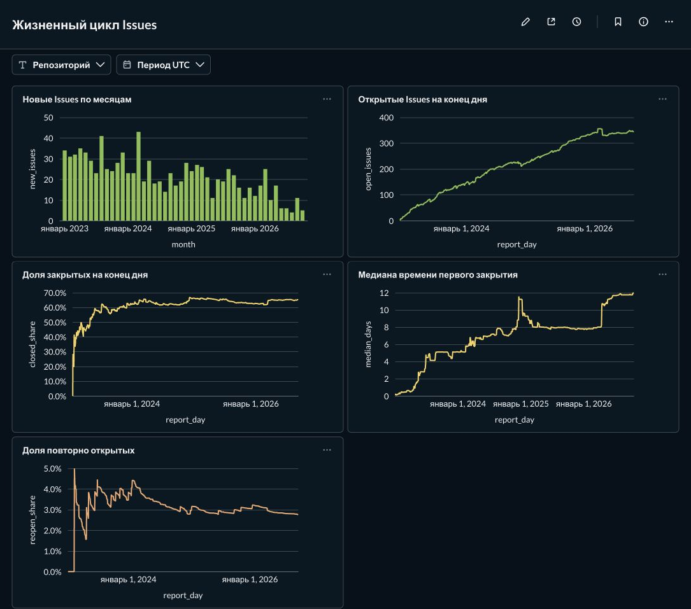
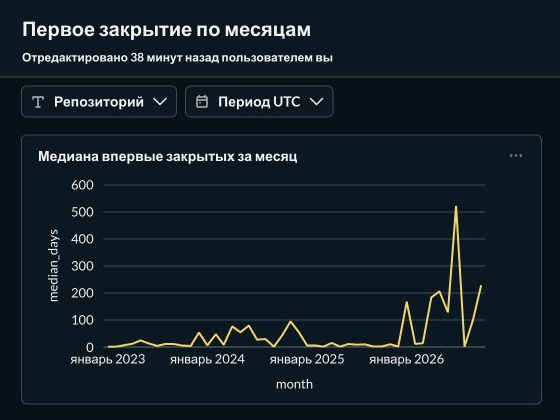
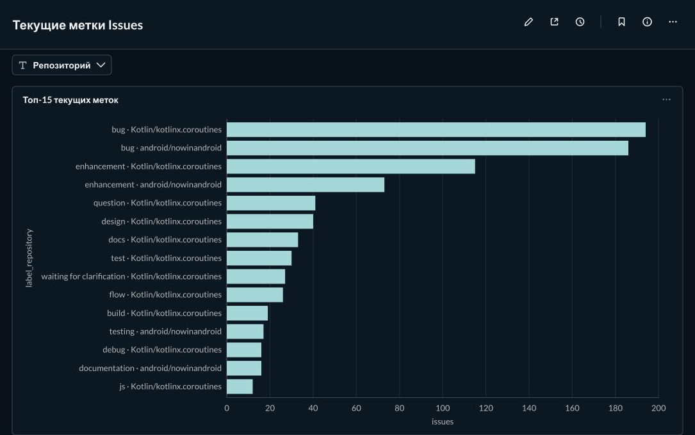
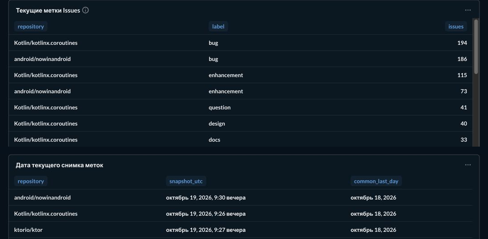

# GitHub Issues Analytics

Учебное аналитическое хранилище для жизненного цикла GitHub Issues из `Kotlin/kotlinx.coroutines`, `ktorio/ktor` и `android/nowinandroid`. Выборка: Issues, созданные с 1 января 2023 года, без Pull Requests, с доступной историей изменений. Целевой поток: GitHub REST API → STG → DDS → CDM → Metabase, под управлением Apache Airflow.

Реализованы Docker Compose/PostgreSQL, загрузчики STG, DDS и CDM, ручной Airflow DAG полного конвейера и воспроизводимая настройка Metabase. На этом Mac полный запуск **20.10.2026 по московскому времени** опубликовал 994 Issues, 4 556 событий DDS и 816 202 строки дневной витрины CDM; общий последний полный отчётный день — 18.10.2026 UTC. Прежняя выгрузка **18.10.2026 на другом компьютере** содержала 993 Issues; её объём не является ожидаемым для нового запуска. Подробности прежнего снимка — в [отчёте](STG_FULL_LOAD_REPORT.md), текущего — в [журнале](docs/CDM_WORKLOG.md).

Для проверки показателей используйте [словарь CDM и дашбордов](docs/CDM_METRICS.md) и [журнал изменений](docs/CDM_WORKLOG.md). Исторические контракты STG/DDS и заметки передачи сохранены в `docs/`.

## Состав окружения

| Компонент | Образ | Назначение |
| --- | --- | --- |
| PostgreSQL | `postgres:16.15` | Аналитическая база и отдельная служебная база Metabase |
| PostgreSQL | `postgres:16.15` | Отдельная база метаданных Airflow |
| Apache Airflow | `apache/airflow:3.3.2` | API server, scheduler, DAG processor, одноразовая инициализация; `LocalExecutor` |
| Metabase | `metabase/metabase:v0.63.18` | Веб-интерфейс аналитики |

Все сервисы подключены к сети Compose `internal`. PostgreSQL Airflow не опубликован на хосте. Аналитический PostgreSQL и веб-интерфейсы доступны только через `127.0.0.1`. Данные обоих PostgreSQL хранятся в именованных Docker volumes; логи Airflow также сохраняются в volume. Metabase хранит свои настройки в отдельной базе `metabaseapp` аналитического экземпляра PostgreSQL.

## Запуск на Windows и macOS

Нужны Docker Desktop и современный `docker compose` (V2 или новее). На Windows выполняйте команды в Git Bash, на macOS — в Terminal. Для Airflow выделите Docker Desktop не менее 4 ГБ оперативной памяти; 8 ГБ удобнее для одновременного запуска Metabase.

1. Клонируйте репозиторий и перейдите в его каталог:

   ```bash
   git clone https://github.com/darten125/github-issues-analytics.git
   cd github-issues-analytics
   ```

2. Создайте локальный файл настроек:

   ```bash
   cp .env.example .env
   ```

3. Сгенерируйте случайные значения паролей и ключей. Команда использует образ Airflow, поэтому отдельная установка Python не нужна:

   ```bash
   docker run --rm apache/airflow:3.3.2 python -c 'import secrets; from cryptography.fernet import Fernet; print("ANALYTICS_DB_PASSWORD=" + secrets.token_hex(24)); print("AIRFLOW_DB_PASSWORD=" + secrets.token_hex(24)); print("AIRFLOW_ADMIN_PASSWORD=" + secrets.token_hex(24)); print("AIRFLOW_FERNET_KEY=" + Fernet.generate_key().decode()); print("AIRFLOW_JWT_SECRET=" + secrets.token_hex(32)); print("METABASE_DB_PASSWORD=" + secrets.token_hex(24)); print("METABASE_ADMIN_PASSWORD=" + secrets.token_hex(24)); print("CDM_READ_PASSWORD=" + secrets.token_hex(24))'
   ```

   Откройте `.env` в редакторе и заполните пустые значения соответствующими строками из вывода; для `METABASE_ADMIN_EMAIL` укажите адрес администратора. Значения имён баз, пользователей и портов можно оставить как в примере. Пароли баз данных должны состоять из URL-безопасных символов; команда выше выдаёт шестнадцатеричные значения. Не добавляйте `.env` в Git и не публикуйте вывод генератора.

4. Проверьте конфигурацию и запустите окружение:

   ```bash
   docker compose config --quiet
   docker compose up -d --wait --wait-timeout 600
   docker compose ps --all
   ```

   `config --quiet` проверяет подстановку переменных и Compose-синтаксис, не выводя пароли. Первый запуск скачивает образы и инициализирует базы; Metabase может запускаться несколько минут. Сервис `airflow-init` должен завершиться с кодом `0`, остальные — быть `healthy`.

5. Откройте [Airflow](http://localhost:8080) и войдите с `AIRFLOW_ADMIN_USERNAME` / `AIRFLOW_ADMIN_PASSWORD` из `.env`. Для первого полного запуска установите `repository=all`, `mode=backfill`, `max_issues=null`, `full_load=true`. После успешной публикации CDM выполните `python3 scripts/provision_metabase.py` на хосте и откройте [Metabase](http://localhost:3000). Он подключается к аналитической БД через роль `cdm_reader`, имеющую доступ только к витринам CDM.

## Проверка и управление

Проверить схемы аналитической базы из Git Bash:

```bash
docker compose exec -T analytics-db psql -U analytics -d github_issues -Atc "SELECT schema_name FROM information_schema.schemata WHERE schema_name IN ('stg','dds','cdm') ORDER BY schema_name"
```

Ожидаются три строки: `cdm`, `dds`, `stg`. Также можно проверить сервисы:

```bash
docker compose exec -T airflow-db pg_isready -U airflow -d airflow
curl -fsS http://localhost:8080/api/v2/monitor/health
curl -fsS http://localhost:3000/api/health
```

При неполадках:

```bash
docker compose ps --all
docker compose logs --tail=100 analytics-db airflow-db airflow-init airflow-apiserver airflow-scheduler airflow-dag-processor metabase
```

Остановить контейнеры, сохранив базы:

```bash
docker compose down
```

Повторный запуск: `docker compose up -d --wait --wait-timeout 600`. Не используйте `docker compose down -v`, если хотите сохранить данные: эта команда удаляет volumes. Скрипт `docker/postgres/init/10-init.sh` запускается только при **первой** инициализации пустого volume аналитической базы. Изменение паролей баз в `.env` после первого запуска не меняет существующие роли PostgreSQL автоматически.

## Структура проекта

- `dags/` — определения DAG для Airflow.
- `src/stg/`, `src/dds/`, `src/cdm/` — Python-код этапов.
- `sql/stg/`, `sql/dds/`, `sql/cdm/` — SQL каждого этапа.
- `tests/stg/`, `tests/dds/`, `tests/cdm/` — тесты по зонам ответственности.

В контейнерах Airflow каталоги `dags`, `src` и `sql` смонтированы только для чтения. Python-код из `src` импортируется как `src.stg`, `src.dds` или `src.cdm`; SQL доступен по `/opt/airflow/sql`.

## Ручной запуск полного конвейера через Airflow

DAG `github_issues_stg` запускает STG, затем DDS и CDM в одном ручном конвейере. Автоматическое расписание отключено (`schedule=None`, `catchup=False`); одновременно допускается только один запуск и одна задача DAG. Для `all` три репозитория обрабатываются строго по порядку: `Kotlin/kotlinx.coroutines` → `ktorio/ktor` → `android/nowinandroid`. Выборочный запуск проверяет только STG и пропускает публикации DDS/CDM.

После запуска Compose откройте [Airflow](http://localhost:8080), войдите с учётной записью из `.env` и найдите `github_issues_stg` в списке DAG. При первом создании DAG может быть на паузе; включите его в интерфейсе. Отсутствие расписания сохраняется и после включения. Нажмите **Trigger DAG** и проверьте параметры в форме:

| Параметр | По умолчанию | Назначение |
| --- | --- | --- |
| `repository` | `Kotlin/kotlinx.coroutines` | Один из трёх репозиториев либо `all` в указанном порядке. |
| `mode` | `backfill` | `backfill` возобновляет первоначальную загрузку; `sync` проверяет изменённые Issues; `audit` принудительно перечитывает `/events`. |
| `created_since` | `2023-01-01T00:00:00Z` | Включительная граница создания Issue с часовым поясом. Сохраняется в партии (`stg.load_batches.created_since`) и передаётся в результате `verify_*`. |
| `max_issues` | `8` | Положительное ограничение на каждый репозиторий; `null` означает отсутствие ограничения. |
| `full_load` | `false` | Явное разрешение полной загрузки. |

Безопасная проверка — оставить значения по умолчанию и запустить DAG вручную. При `full_load=false` значение `max_issues=null` запрещено. При `full_load=true` обязательно задайте `max_issues=null` (в форме Airflow это JSON `null`); сочетание с числовым лимитом также запрещено. Проверка происходит в первой задаче **до любых запросов GitHub**. `Param` ограничивает значения в форме, а задача `validate_run` дополнительно проверяет сочетания и дату по фактическим параметрам этого запуска.

Цепочка задач: `validate_run` → `check_resources` → `prepare_stg_schema` → три пары `load_*`/`verify_*` → `summarize` → `publish_dds` → `publish_cdm`. Проверка каждого репозитория читает его `batch_id` из PostgreSQL. Для выборки нужны `status=succeeded` и `issue_scan_status=sample`; для полной загрузки — `status=succeeded` и `issue_scan_status=verified`. Запуск `sample` пропускает DDS и CDM. Полный запуск одного репозитория обновляет оба слоя, если публикации остальных двух уже готовы; при неполной готовности CDM завершается ошибкой и сохраняет предыдущие витрины. Если полный обход завершил HTTP-запросы, но наборы Issue ID не стабилизировались (`unverified`), проверка завершится ошибкой. `verified` означает практическое совпадение наборов ID в контрольных проходах, а не абсолютную гарантию отсутствия изменений GitHub между запросами.

Откройте запуск DAG в Airflow: в графе выберите задачу и вкладку **Logs** для её сообщений. `load_*` сохраняет `batch_id`, а `verify_*` показывает статус и счётчики; XCom содержит только эти небольшие технические данные, без исходных JSON. В PostgreSQL проверьте последнюю партию:

```sql
SELECT batch_id, repository_full_name, load_mode, status, issue_scan_status,
       issue_scan_passes, issues_selected, events_fetched,
       issue_versions_inserted, event_versions_inserted, started_at, finished_at
FROM stg.load_batches
ORDER BY started_at DESC LIMIT 10;
```

При ошибке посмотрите логи неуспешной задачи и состояние партии. После устранения причины запустите DAG вручную с теми же параметрами или очистите неуспешную задачу в интерфейсе Airflow для повтора. Повтор загрузки создаёт новую партию; `backfill` использует существующее возобновление завершённых историй и не очищает STG. Задачи загрузки имеют не более одного повтора через 15 минут после неуспеха; клиент GitHub отдельно выполняет ограниченные повторы отдельных временно неудачных запросов. Не запускайте параллельно CLI-загрузчик для той же выборки.

Отчёт о предыдущей полной выгрузке хранится в [STG_FULL_LOAD_REPORT.md](STG_FULL_LOAD_REPORT.md); её volume не входит в репозиторий. Для нового пустого окружения сначала оцените лимиты GitHub API и проверьте малую выборку; затем вручную выберите `repository=all`, `mode=backfill`, `full_load=true`, `max_issues=null`. После каждого репозитория проверьте `status=succeeded`, `issue_scan_status=verified` и незавершённые попытки `/events` по запросам ниже. После `summarize` DAG сам публикует DDS и CDM; партии `sample` в эти слои не передаются.

## Загрузка STG

В `.env` задайте `GITHUB_TOKEN` с доступом на чтение публичных Issues. Для создания токена используются [настройки GitHub](https://docs.github.com/en/authentication/keeping-your-account-and-data-secure/managing-your-personal-access-tokens); не записывайте его в отслеживаемые файлы. `GITHUB_CREATED_SINCE` по умолчанию равен `2023-01-01T00:00:00Z`. Отсутствие токена не мешает запуску инфраструктуры, но команда `load` завершится с ошибкой. После изменения `.env` выполните `docker compose up -d --wait --wait-timeout 600`: Compose пересоздаст scheduler с новыми переменными.

Применить SQL-схему к уже инициализированной базе (без GitHub-токена):

```bash
docker compose run --rm --no-deps airflow-scheduler python -m src.stg.cli init-db
```

Команда последовательно применяет `sql/stg/001_create_tables.sql`, `002_observations_and_issue_loads.sql`, `003_audit_and_issue_scan.sql` и `004_cohort_boundary.sql`; все четыре файла можно выполнять повторно. Загрузчик также применяет их перед загрузкой. Миграции не удаляют прежние строки. Для существующих снимков `002` переносит известные первое и последнее наблюдения, но не может восстановить пропущенные промежуточные наблюдения. Прежние загрузки не получают подтверждения полноты на уровне Issue или контрольного прохода: их события потребуется проверить `backfill`, а полноту перечисления — новым полным запуском без `--max-issues`.

Проверочная загрузка одного репозитория и восьми Issues вместе со всеми доступными страницами их событий:

```bash
docker compose run --rm --no-deps airflow-scheduler python -m src.stg.cli load --mode backfill --repository Kotlin/kotlinx.coroutines --max-issues 8
```

`--mode backfill` — режим по умолчанию. Он сохраняет текущие снимки Issues, но не запрашивает `/events` повторно для Issue, по которому уже есть успешный полный обход страниц в `stg.issue_event_loads`. После сбоя повторный запуск вновь проходит список Issues, однако пропускает **истории** завершённых задач; незавершённые обрабатываются с первой страницы. Прогресс хранится по стабильному GitHub `issue_id`, а не номеру страницы. `--max-issues` ограничивает число выбранных Issues для проверки; при повторном запуске с тем же пределом уже обработанные Issues всё ещё входят в эти первые N, поэтому для продолжения полной первоначальной загрузки запускайте команду **без** `--max-issues`. Ограниченный запуск получает статус `issue_scan_status=sample` и не выполняет контрольные проходы.

Для последующих изменений используйте отдельный режим:

```bash
docker compose run --rm --no-deps airflow-scheduler python -m src.stg.cli load --mode sync --repository Kotlin/kotlinx.coroutines
```

`sync` вновь просматривает список Issues, сохраняет наблюдения текущих JSON и сравнивает GitHub `updated_at` с временем успешной загрузки событий конкретного Issue. Для новых или изменившихся Issues он заново обходит все страницы `/events`; идентичные события и JSON-снимки не дублируются. Для неизменившихся Issues историю не запрашивает. При отсутствии `updated_at` безопасно повторяет обход. Это простой режим без `since` и курсора: он заново читает страницы **списка** до даты создания, поэтому расходует запросы на большой выборке, но не привязывает продолжение к нестабильному номеру страницы. Он может не заметить событие, которое не меняет `updated_at`; для принудительной сверки используйте `audit`.

```bash
docker compose run --rm --no-deps airflow-scheduler python -m src.stg.cli load --mode audit --repository Kotlin/kotlinx.coroutines --max-issues 8
```

`audit` обходит `/events` выбранных Issues независимо от `updated_at`. Каждая попытка фиксируется в `stg.issue_event_loads` с режимом `audit`; повторный ответ без изменений создаёт новое подтверждение обхода, но не новую JSON-версию события. Ограничивайте проверку флагом `--max-issues`; полный `audit` потребует запрос истории каждого Issue.

При запуске **без** `--max-issues` загрузчик делает первый проход списка и до двух контрольных проходов. Он сравнивает наборы глобальных `issue_id` соседних проходов, обрабатывает вновь обнаруженные Issues и выставляет `issue_scan_status=verified` только при совпадении двух последовательных наборов. Если они остаются разными, результат `unverified`, даже если партия завершилась без ошибки. `issue_scan_passes` и `issue_scan_issue_count` показывают число проходов и размер последнего набора. `verified` означает наблюдавшуюся стабильность перечня в этих проходах, а не абсолютную полноту GitHub: страницы не представляют единый снимок во времени и могут измениться позже.

`--repository` можно повторять для выбора нескольких репозиториев, а без него выбираются все три. Дату можно переопределить флагом `--created-since 2023-01-01T00:00:00Z` или через `.env`. Фактическая граница каждого запуска сохраняется в партии: `stg.load_batches.created_since` с `created_since_source='recorded'`. DDS публикует только партии с границей `2023-01-01T00:00:00Z`. Полную выгрузку запускайте только после оценки лимита GitHub API и ресурсного бюджета. Предыдущая полная загрузка выполнена через Airflow DAG, а не через CLI.

Партии, созданные до миграции `004`, получают `created_since_source='unknown'`: миграция их автоматически не переименовывает. Это касается и полной выгрузки от 18.10.2026. Если исходная конфигурация запуска сохранена (для этой выгрузки — `DagRun.conf` в [отчёте](STG_FULL_LOAD_REPORT.md)), подтвердите границу отдельной командой. Токен GitHub для неё не нужен, статусы и счётчики партии она не меняет:

```bash
docker compose run --rm --no-deps airflow-scheduler python -m src.stg.cli attest-cohort --batch-id '<UUID>' --created-since 2023-01-01T00:00:00Z --evidence 'DagRun <run_id>: conf created_since; STG_FULL_LOAD_REPORT.md'
```

Команда применяется только к завершённой партии с неизвестной границей. Повтор с тем же значением ничего не меняет, другое значение отклоняется.

Клиент выполняет только `GET /repos/{owner}/{repo}`, `GET /repos/{owner}/{repo}/issues` и `GET /repos/{owner}/{repo}/issues/{issue_number}/events`. Для Issues он задаёт `state=all`, `sort=created`, `direction=desc`, `per_page=100`; следующие страницы берутся из заголовка `Link`. Pull Requests исключаются по полю `pull_request`. Загрузка прекращается при достижении `created_at` старше границы, поскольку список сортируется по времени создания. Параметр GitHub `since` здесь не используется: он фильтрует по времени **последнего обновления**, а не создания. Страницы сохраняются последовательно, без накопления всей выгрузки в памяти. Временные сетевые ошибки, HTTP 429/5xx и 403, связанный с rate limit, повторяются не более трёх раз с учётом `Retry-After` и `X-RateLimit-Reset`. Если требуемое ожидание превышает 120 секунд, загрузка завершается ошибкой для последующего запуска.

### Таблицы и повторные загрузки

| Таблица | Зерно и ключ | Назначение |
| --- | --- | --- |
| `stg.load_batches` | `batch_id` (UUID) | Статус, режим (`load_mode`), время, счётчики, итог сверки списка Issues (`issue_scan_status`, `issue_scan_passes`, `issue_scan_issue_count`) и граница выгрузки (`created_since`, `created_since_source`, `created_since_evidence`, `created_since_attested_at`) |
| `stg.repositories_raw` | `snapshot_id`; уникально `(repository_id, payload_sha256)` | JSONB-снимки репозитория |
| `stg.issues_raw` | `snapshot_id`; уникально `(issue_id, payload_sha256)` | JSONB-снимки Issue, номер внутри репозитория отдельно от GitHub ID |
| `stg.issue_events_raw` | `snapshot_id`; уникально `(event_id, payload_sha256)` | JSONB-снимки событий из `/events` |
| `stg.repository_observations`, `stg.issue_observations`, `stg.event_observations` | `observation_id`; уникально `(batch_id, snapshot_id)` | Один факт наблюдения конкретной JSON-версии за одну партию |
| `stg.issue_event_loads` | `(batch_id, issue_id)` | Режим, начало, завершение, ошибка и число событий полного обхода `/events` для Issue |

Хеш вычисляется из канонического JSON. Одинаковый ответ повторно не вставляется: у существующего снимка обновляются `last_seen_at` и `last_batch_id`. Изменённый JSON получает новый снимок, прежнее состояние остаётся доступным. Одновременно записывается наблюдение со ссылкой на `snapshot_id` и `batch_id`. Повторная обработка той же версии в одной партии не создаёт второй записи наблюдения. Поэтому A → B → A в трёх партиях даёт два снимка и три наблюдения. `last_seen_at` — совместимое со старой схемой поле; точную известную последовательность после миграции читайте по таблице наблюдений. В событиях `github_created_at` — время события на GitHub, а `observed_at` — время нашего наблюдения. Счётчики `*_versions_inserted` показывают число новых уникальных снимков, а не наблюдений.

Для каждого обрабатываемого Issue создаётся строка `stg.issue_event_loads` со статусом `running` **до** запроса `/events`. Сохранение страницы событий и увеличение `events_fetched` этой строки выполняются одной транзакцией. `succeeded` устанавливается только после завершения всех страниц; при ошибке — `failed`, уже сохранённые страницы остаются. Последняя успешная загрузка определяется по максимальному `finished_at` среди строк `succeeded`; последняя попытка может быть неуспешной. При аварийном завершении процесса строка партии или Issue может остаться `running` и должна считаться незавершённой. Новый запуск создаёт новую партию и новую попытку, не меняя прежний `running`: запись может принадлежать ещё работающему процессу. `succeeded` подтверждает обход всех доступных страниц **именно `/events` на момент запроса**, а не абсолютно полную историю GitHub Issue.

### Проверка через DBeaver или psql

Из DBeaver подключитесь к `localhost:5433`, базе `github_issues`, пользователю `analytics` и паролю `ANALYTICS_DB_PASSWORD` из `.env`. Из Git Bash можно открыть `docker compose exec analytics-db psql -U analytics -d github_issues`. Примеры запросов:

```sql
SELECT batch_id, repository_full_name, load_mode, status,
       issue_scan_status, issue_scan_passes, issue_scan_issue_count,
       started_at, finished_at,
       issues_fetched, issues_selected, issue_versions_inserted,
       events_fetched, event_versions_inserted, error_count
FROM stg.load_batches ORDER BY started_at DESC LIMIT 10;

-- Последний полный проход для каждого репозитория. sample и старые legacy не подтверждают список.
SELECT DISTINCT ON (repository_full_name)
       repository_full_name, batch_id, load_mode, status,
       issue_scan_status, issue_scan_passes, issue_scan_issue_count, finished_at
FROM stg.load_batches
WHERE issue_scan_status IN ('verified', 'unverified')
ORDER BY repository_full_name, started_at DESC, batch_id DESC;

-- Партии, оставшиеся running. Возраст сам по себе не доказывает остановку процесса.
SELECT batch_id, repository_full_name, load_mode, status,
       issue_scan_status, started_at, now() - started_at AS age
FROM stg.load_batches
WHERE status = 'running'
ORDER BY started_at;

-- Незавершённые попытки получения /events, включая партии с иным статусом.
SELECT l.batch_id, b.repository_full_name, b.status AS batch_status,
       l.issue_id, l.mode, l.status AS issue_status,
       l.started_at, now() - l.started_at AS age
FROM stg.issue_event_loads l
JOIN stg.load_batches b USING (batch_id)
WHERE l.status = 'running'
ORDER BY l.started_at;

-- Последнее наблюдавшееся состояние одного Issue.
SELECT i.issue_id, i.issue_number, i.raw_json, o.observed_at, o.batch_id
FROM stg.issue_observations o
JOIN stg.issues_raw i ON i.snapshot_id = o.snapshot_id
WHERE i.issue_id = 123456789 -- замените на нужный GitHub issue_id
ORDER BY o.observed_at DESC, o.observation_id DESC LIMIT 1;

-- Последовательность известных наблюдений, включая A → B → A.
SELECT o.observation_id, o.batch_id, o.observed_at,
       i.snapshot_id, i.payload_sha256, i.raw_json->>'state' AS state
FROM stg.issue_observations o
JOIN stg.issues_raw i ON i.snapshot_id = o.snapshot_id
WHERE i.issue_id = 123456789
ORDER BY o.observed_at, o.observation_id;

-- Уникальные события одного Issue: последнее наблюдавшееся JSON-состояние каждого event_id.
WITH latest_event AS (
    SELECT DISTINCT ON (e.event_id)
           e.event_id, e.issue_id, e.event_type, e.github_created_at,
           e.raw_json, o.observed_at
    FROM stg.issue_events_raw e
    JOIN stg.event_observations o ON o.snapshot_id = e.snapshot_id
    WHERE e.issue_id = 123456789
    ORDER BY e.event_id, o.observed_at DESC, o.observation_id DESC
)
SELECT * FROM latest_event ORDER BY github_created_at, event_id;

-- Issues с незавершённой или ещё не подтверждённой историей для актуального updated_at.
WITH latest_issue AS (
    SELECT DISTINCT ON (i.issue_id) i.issue_id, i.repository_id, i.issue_number,
           (i.raw_json->>'updated_at')::timestamptz AS issue_updated_at
    FROM stg.issues_raw i
    JOIN stg.issue_observations o ON o.snapshot_id = i.snapshot_id
    ORDER BY i.issue_id, o.observed_at DESC, o.observation_id DESC
)
SELECT i.*, l.status, l.events_fetched, l.error_message
FROM latest_issue i
LEFT JOIN LATERAL (
    SELECT status, issue_updated_at, events_fetched, error_message
    FROM stg.issue_event_loads l WHERE l.issue_id = i.issue_id
    ORDER BY started_at DESC, batch_id DESC LIMIT 1
) l ON true
WHERE l.status IS DISTINCT FROM 'succeeded'
   OR i.issue_updated_at IS NULL
   OR l.issue_updated_at IS DISTINCT FROM i.issue_updated_at;

-- Только Issues с подтверждённым успешным обходом /events для текущего updated_at.
WITH latest_issue AS (
    SELECT DISTINCT ON (i.issue_id) i.issue_id, i.repository_id, i.issue_number,
           i.raw_json, (i.raw_json->>'updated_at')::timestamptz AS issue_updated_at
    FROM stg.issues_raw i
    JOIN stg.issue_observations o ON o.snapshot_id = i.snapshot_id
    ORDER BY i.issue_id, o.observed_at DESC, o.observation_id DESC
)
SELECT i.issue_id, i.repository_id, i.issue_number, i.raw_json,
       l.finished_at AS last_successful_event_load_at
FROM latest_issue i
JOIN LATERAL (
    SELECT status, issue_updated_at, finished_at
    FROM stg.issue_event_loads l WHERE l.issue_id = i.issue_id
    ORDER BY started_at DESC, batch_id DESC LIMIT 1
) l ON true
WHERE l.status = 'succeeded'
  AND i.issue_updated_at IS NOT NULL
  AND l.issue_updated_at = i.issue_updated_at;
```

Эти запросы — диагностика STG. Публикация DDS не выбирает «последнюю» партию сама: она принимает явные UUID и проверяет их по правилам [контракта DDS](docs/DDS_CONTRACT.md), включая границу когорты. Для диагностики полноты смотрите **последнюю полную партию** репозитория: нужны `status='succeeded'` и `issue_scan_status='verified'`. Ограниченные `sample` и старые `legacy` не подтверждают перечень. Для каждого Issue отдельно проверяйте успешную попытку `/events` для текущего `updated_at`; приведённый выше консервативный запрос требует, чтобы успешной была именно последняя попытка. `running` и `failed` проверяйте отдельно, не переводите в `succeeded` по возрасту записи: сначала убедитесь, что соответствующий процесс действительно завершён. При `unverified` повторите полный проход или исследуйте изменения списка, прежде чем считать охват подтверждённым.

Для тестов без токена:

```bash
MSYS_NO_PATHCONV=1 docker compose run --rm --no-deps -v "$(pwd -W)/tests:/opt/airflow/tests:ro" airflow-scheduler python -m unittest discover -s tests/stg -v
```

Для интеграционного теста записи в текущий PostgreSQL добавьте `-e STG_INTEGRATION=1` перед `-v`. Тест использует временные идентификаторы и удаляет свои строки после проверки.

### Границы данных

`/issues/{number}/events` и [`/issues/{number}/timeline`](https://docs.github.com/en/rest/issues/timeline) возвращают разные наборы активности. Нужные для аналитики переходы [`closed` и `reopened` документированы для `/events`](https://docs.github.com/en/rest/using-the-rest-api/issue-event-types). В STG сохраняются **все полученные страницы `/events`**, но не комментарии и не все типы timeline-событий; это не исчерпывающая история каждого изменения Issue. У GitHub нет снимка страниц на одну точку времени: при изменениях репозитория во время долгой загрузки возможны сдвиги пагинации, поэтому даже успешный статус не доказывает, что не было пропусков. Контрольные проходы сравнивают наборы ID и обнаруживают часть таких сдвигов, но совпадение двух наборов не является математической гарантией. Наблюдения фиксируют только состояния, реально полученные загрузчиком. Для SCD2 на следующем этапе нужно учитывать эти ограничения и различать время GitHub-события и время нашего наблюдения. Разработчику DDS следует связывать объекты по глобальным `issue_id`/`event_id`, а `issue_number` использовать вместе с `repository_id`; для выбора текущего состояния применять `stg.issue_observations`, а для отбора подтверждённых историй — `stg.issue_event_loads` вместе с `stg.load_batches`.

## Основа конфигурации

Конфигурация адаптирует [официальный пример Airflow для Docker Compose](https://airflow.apache.org/docs/apache-airflow/3.3.2/howto/docker-compose/) под [LocalExecutor](https://airflow.apache.org/docs/apache-airflow/3.3.2/core-concepts/executor/index.html): без Celery worker, брокера Redis и triggerer, который понадобится только для deferrable tasks. Порядок старта задают [healthcheck и `depends_on`](https://docs.docker.com/compose/how-tos/startup-order/). Служебная база Metabase следует [рекомендации Metabase использовать PostgreSQL](https://www.metabase.com/docs/latest/installation-and-operation/configuring-application-database).

## DDS и история статусов — участник 2

DDS нормализует подтверждённые STG-партии, сохраняет события и восстанавливает SCD2 статусов. [Контракт DDS](docs/DDS_CONTRACT.md) описывает модель и проверки; [SQL-примеры](docs/sql/DDS_READ_QUERIES.sql) показывают чтение истории. Полный DAG вызывает DDS автоматически; его также можно вызвать отдельно:

```bash
docker compose run --rm --no-deps airflow-scheduler python -m src.dds.cli load --batch-id '<UUID>'
docker compose run --rm --no-deps airflow-scheduler python -m src.dds.cli validate --batch-id '<UUID>'
```

`load` применяет миграции DDS автоматически. Передавайте 1–3 конкретных UUID из STG `summarize`, по одному на репозиторий. Нужны `succeeded/verified` с минимум двумя проходами, подтверждённая история и сохранённая граница `created_since=2023-01-01T00:00:00Z`. Партии, выгруженные до миграции STG `004`, сначала подтверждаются командой `python -m src.stg.cli attest-cohort` по сохранённой конфигурации запуска (см. контракт DDS). Для нескольких партий повторяйте `--batch-id`. Публикация выбранного набора атомарна, старые партии не заменяют новые, повтор не переписывает неизменившиеся строки и сохраняет ID интервалов. `coverage_complete` означает наличие текущих публикаций всех трёх репозиториев. Готовность для CDM показывает `dds.publication_manifest.ready_for_cdm`.

`preview --batch-id '<UUID>'` допускает успешную выборку `sample` и ничего не записывает; `init-db` отдельно применяет миграции; `validate` без параметров проверяет текущий DDS целиком. Настройки `DWH_DB_*` и драйвер уже есть в образе Airflow; токен GitHub для DDS не нужен. `converted_to_discussion` считается закрытием по времени события. `reopened` без известного закрытия и бизнес-даты позже партии блокируют публикацию. Текущие метки и исполнители не имеют истории SCD2. Восстановленный статус проверяется против исходного снимка, без вымышленных событий. Входы, нормативные правила показателей и воспроизводимый тестовый DDS для участника 3 описаны в [памятке](docs/CDM_HANDOFF.md).

Тесты в локальном активированном Python-окружении: `python -m unittest discover -s tests/dds -v`. Для интеграции обязательны отдельный PostgreSQL 16, `DDS_INTEGRATION=1` и `DDS_TEST_DSN` с именем базы на `_test`; команды и ограничения приведены в контракте. Полноту рабочего DDS следует подтверждать на реальных партиях, отдельно от тестовых фикстур.

## CDM и Metabase

CDM читает только публикации DDS всех трёх репозиториев. Исторические графики ограничены общим последним полным UTC-днём; текущие метки вынесены отдельно. В приёмочной загрузке этот день — **18.10.2026**. Статус на конец дня определяется непосредственно перед следующей полуночью UTC; после общего горизонта графики ничего не предсказывают. Если репозитории обновлялись в разное время, используется минимальный горизонт. Подробнее о зерне витрин и ограничениях — в [словаре CDM](docs/CDM_METRICS.md).

| График | Что показывает | Временной фильтр |
| --- | --- | --- |
| Новые Issues по месяцам | Число уникальных Issues по UTC-дате создания | Дата создания; неполный крайний месяц допустим |
| Открытые на конец дня | Исторический остаток по интервалам статуса DDS | Отчётная дата |
| Доля закрытых | Закрытые / все созданные к тому же срезу; общая доля из суммарных числителя и знаменателя | Отчётная дата |
| Медиана первого закрытия | Накопительная медиана индивидуальных сроков до первого фактического закрытия | Отчётная дата |
| Доля повторно открытых | Когда-либо повторно открытые / когда-либо закрытые к одному срезу; нулевой знаменатель даёт пустое значение | Отчётная дата |
| Первое закрытие по месяцам | Медиана сроков Issues, впервые закрытых внутри месяца | Дата первого закрытия |
| Текущие метки | Уникальные Issues внутри каждой метки и репозитория; один Issue может входить в несколько меток | Исторического фильтра нет |

Все дашборды фильтруются по репозиторию. Команды для отдельного создания схемы, повтора и проверки:

```bash
docker compose run --rm --no-deps airflow-scheduler python -m src.cdm.cli init-db
docker compose run --rm --no-deps airflow-scheduler python -m src.cdm.cli load
docker compose run --rm --no-deps airflow-scheduler python -m src.cdm.cli validate
python3 scripts/provision_metabase.py
```

Сценарий Metabase создаёт источник `GitHub Issues CDM`, девять вопросов и три дашборда, затем обновляет эти же объекты при повторном запуске. Дашборд меток показывает читаемый топ-15 и полную таблицу всех меток. Учётные данные администратора и `cdm_reader` берутся из локального `.env` и не выводятся. Записи о реализации и проверках находятся в [журнале CDM](docs/CDM_WORKLOG.md).

Для ручной сверки с DDS есть [read-only SQL](docs/sql/CDM_DDS_RECONCILIATION.sql).

## Результат: дашборды Metabase

Снимки сделаны на рабочем экземпляре после полного `backfill` трёх репозиториев, без выбранных фильтров. Исторические показатели показаны по **18.10.2026 UTC**, последнему общему полному дню. На эту дату в CDM было 994 Issues: 346 открытых и 648 закрытых (65,19%); медиана времени до первого закрытия — 11,96 дня; повторно открывались 18 из 651 когда-либо закрытых (2,76%). При следующей загрузке графики и значения могут измениться.

### Жизненный цикл Issues



Пять графиков показывают приток задач по месяцам и состояние всей накопленной выборки на конец каждого дня UTC. Фильтры «Репозиторий» и «Период UTC» применяются к историческим карточкам с соответствующей датой.

### Первое закрытие по месяцам



Здесь медиана считается среди Issues, впервые закрытых **внутри месяца**. Поэтому она отличается от накопительной медианы на предыдущем дашборде; резкие пики могут возникать в месяцах с небольшим числом закрытий. Временной фильтр относится к дате первого закрытия.

### Текущие метки



Ниже — фрагмент полной таблицы из 48 пар «репозиторий — метка» и время исходного снимка для каждого репозитория.



Метки отражают только текущий снимок, поэтому фильтра по исторической дате здесь нет. Один Issue может иметь несколько меток; суммы строк не равны числу уникальных Issues.
